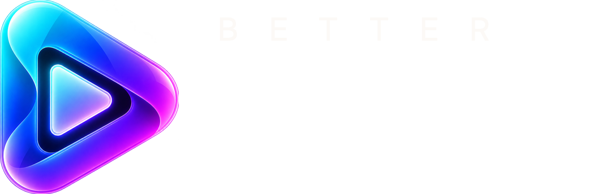

<p align="center">
  
</p>

<h1 align="center">Better Nuvio for iOS</h1>

<p align="center">Fork by Pedro Alencar · the iPhone and iPad companion of Better Nuvio for TV.</p>

## Install

Better Nuvio for iOS is distributed as an IPA for AltStore and SideStore. Releases are published on
[GitHub](https://github.com/alenkpedro/better-nuvio-ios/releases) and announced on the Better Nuvio Discord.

## Build

```bash
git clone --recurse-submodules https://github.com/alenkpedro/better-nuvio-ios.git
cd better-nuvio-ios
./scripts/build-ios-ipa.sh
```

## Credits

Better Nuvio is built on top of open source work:

- [Nuvio Mobile](https://github.com/NuvioMedia/NuvioMobile) by Tapframe and contributors, the original app.
- [NuvioMobile-Enhanced](https://github.com/luqmanfadlli/NuvioMobile-Enhanced) by luqmanfadlli, the fork this one starts from.

## License

GPL-3.0, the same as the upstream projects. See [LICENSE](LICENSE).
